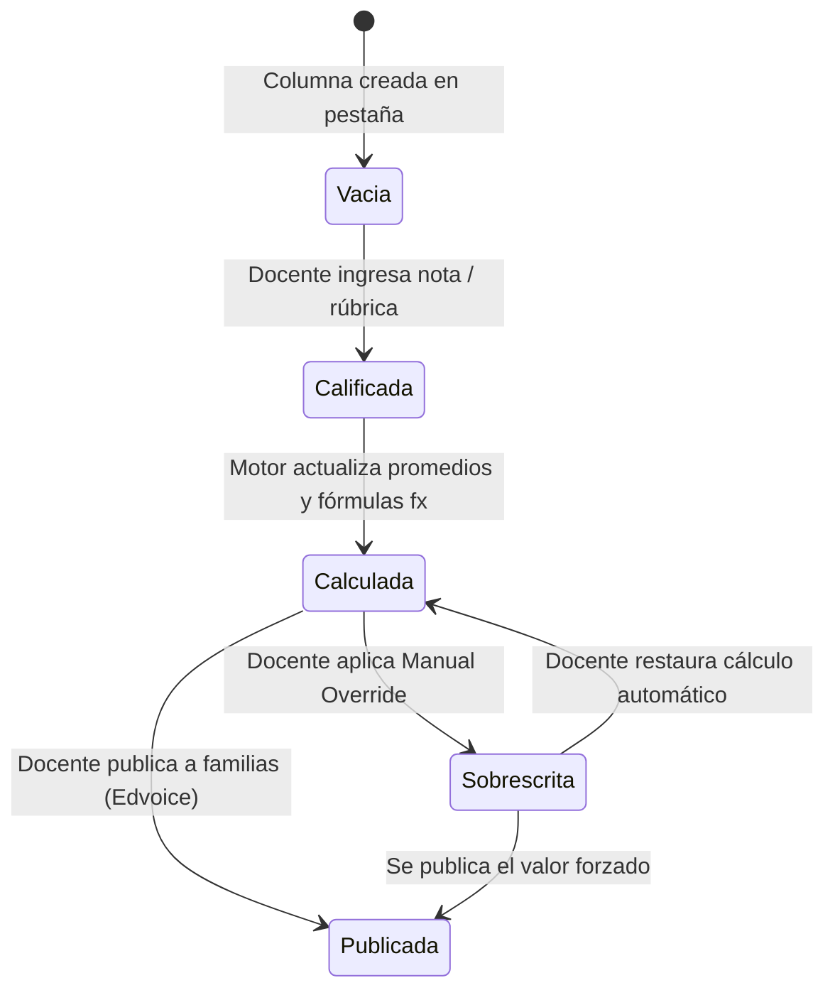

# Análisis Funcional: Cuaderno de Notas (Gradebook) — Additio App

> **Plataforma analizada:** Additio App ([https://www.additioapp.com](https://www.additioapp.com))  
> **Módulo:** 01. Cuaderno de notas / Gradebook (tipos de columnas, pestañas, medias ponderadas, fórmulas `fx`, sobrescritura de notas, omitir vacíos, formato condicional)  
> **Metodología:** Ingeniería inversa funcional de caja limpia (*Clean Room Reverse Engineering*) basada en documentación técnica pública, guías de ayuda oficial de Additio/Sdui, webinars y tutoriales oficiales.  
> **Fecha de análisis:** Octubre 2026  
> **Estado:** Fase 1 a 4 completa para Additio App.

---

## FASE 1 — Recopilación de Información Pública

### 1.1 Fuentes Consultadas y URLs de Referencia
* **Portal de funcionalidades de evaluación:** [Additio App - Cuaderno de Notas y Evaluación](https://additioapp.com/cuaderno-de-notas/)
* **Documentación oficial de cálculos y tipos de columnas:** [Help Center - Tipos de Columnas y Cálculos en el Cuaderno](https://help.additioapp.com/es/knowledge-base/tipos-de-columnas-y-calculos) / [Sdui Group Additio Knowledgebase](https://sdui-group.com)
* **Gestión de Fórmulas Calculadas (`fx`):** [Help Center - Generador de Fórmulas y Cálculos](https://help.additioapp.com/es/knowledge-base/como-crear-una-formula-calculada)
* **Pestañas y Estructura por Evaluaciones:** [Help Center - Organización por Pestañas](https://help.additioapp.com/es/knowledge-base/como-crear-y-gestionar-pestanas)
* **Sobrescritura de Notas y Casos Especiales:** [Help Center - Modificar y Sobrescribir Notas](https://help.additioapp.com/es/knowledge-base/sobrescribir-notas-calculadas)
* **Tipos de Notas, Iconos y Formato Condicional:** [Help Center - Tipos de Nota y Selectores de Iconos](https://help.additioapp.com/es/knowledge-base/tipos-de-nota-e-iconos)
* **Plataforma para Centros Escolares:** [Additio for Schools](https://additioapp.com/centros/)
* **Comunicación y Portal de Familias:** [Edvoice by Additio](https://additioapp.com/edvoice/)
* **Canal Oficial de YouTube:** [Additio App Tutoriales](https://www.youtube.com/@AdditioApp)

---

### 1.2 Estructura de Navegación y Funcionalidades Públicas del Módulo
En Additio App, el cuaderno de notas se fundamenta en un paradigma **"Teacher-First & Spreadsheet-Empowered"** (inspirado en la agilidad de una hoja de cálculo profesional pero con validaciones pedagógicas estrictas):

1. **Estructura Multidimensional por Pestañas (Tabs):**
   * El cuaderno organiza los grupos/clases en pestañas superiores (ej. *1º Trimestre*, *2º Trimestre*, *3º Trimestre*, *Evaluación Final Ordinaria*, *Asistencia*).
   * Soporta cálculos cruzados entre pestañas (*Cross-Tab Calculations*), permitiendo que la columna "Nota Final Anual" en la pestaña de cierre recoja y pondere automáticamente columnas de las pestañas anteriores (ej. $30\% T1 + 30\% T2 + 40\% T3$).
2. **Columnas de Tipos Heterogéneos:**
   * **Columnas de Entrada Manual:** Valores numéricos directos (teclado decimal 0-10, 0-100), selectores textuales (ej. Sobresaliente, Notable, Bien, Suficiente, Insuficiente), selectores de iconos con valor numérico asignado (caras verdes/rojas, estrellas, checks).
   * **Columnas de Categoría (Carpetas de Agrupación):** Actúan como contenedores que agrupan varias subcolumnas (ej. Carpeta "Controles Cortos" con 4 pruebas internas) y calculan automáticamente el valor consolidado de la carpeta.
   * **Columnas de Cálculo:** Medias aritméticas, medias ponderadas, sumatorios y fórmulas avanzadas `fx`.
   * **Columnas de Rúbrica:** Cada celda abre una matriz interactiva de descriptores donde el clic en un nivel traslada el puntaje exacto a la celda del cuaderno.
3. **Panel de Gestión de Celdas:**
   * Clic en celda / clic derecho permite: añadir comentarios cualitativos, adjuntar archivos o audios, aplicar sobrescritura forzada (*Manual Override*) y consultar el desglose de cálculo.

---

### 1.3 Roles Identificados en el Módulo y Matriz de Acceso
| Rol | Permisos y Capacidades en el Cuaderno de Additio |
| :--- | :--- |
| **Administrador / Dirección (Additio for Schools)** | Centraliza y distribuye los grupos y asignaturas a los docentes. Puede definir plantillas de evaluación institucionales (escalas oficiales, criterios unificados). Supervisa notas de cualquier grupo del centro escolar. Exporta actas y boletines oficiales consolidados. |
| **Tutor / Coordinador de Nivel** | Supervisa el rendimiento global de los estudiantes de su tutoría a través de las diferentes materias. Accede a las notas de los demás docentes del equipo docente para las juntas de evaluación trimestrales. |
| **Docente (Profesor)** | Libertad para estructurar su cuaderno: crear pestañas, definir categorías, columnas ponderadas, fórmulas `fx`, asociar rúbricas, configurar códigos de color condicionales y sobrescribir notas manualmente. |
| **Estudiante y Familias (Portal / App Edvoice)** | Consulta en tiempo real de calificaciones y retroalimentaciones publicadas por el profesor. Recepción de notificaciones instantáneas de calificaciones. [SUPUESTO: El docente o el centro deciden si publican columnas individuales o únicamente la nota final de la pestaña]. |

---

### 1.4 Integraciones y APIs Públicas
* **Google Classroom:** Importación directa de alumnos, asignaciones y notas evaluadas en Classroom hacia columnas del cuaderno de Additio.
* **Microsoft Teams for Education:** Integración de tareas y sincronización de calificaciones.
* **Moodle:** Conexión mediante plugin LTI/REST para sincronizar usuarios, cursos y calificaciones.
* **Plataformas de Consejerías de Educación (España):** Exportación de actas adaptadas a normativas autonómicas (Xunta, EducaMadrid, Séneca, etc.).

---

### 1.5 Cómo Solicitar Manualmente una Cuenta Demo en Additio App
> [!IMPORTANT]
> **Pasos para solicitar y probar Additio (Clean Room Compliance):**
> 1. **Docente Individual (Prueba Gratuita):**
>    * Ingresar a [https://web.additioapp.com](https://web.additioapp.com) o descargar la app en Google Play / Apple App Store.
>    * Registrarse con email o SSO (Google / Microsoft). Additio otorga automáticamente una prueba gratuita completa de la versión *Teachers Pro* sin requerir tarjeta de crédito.
> 2. **Centros Escolares (*Additio for Schools*):**
>    * Ingresar a [https://additioapp.com/centros/](https://additioapp.com/centros/) o [https://additioapp.com/demo/](https://additioapp.com/demo/).
>    * Completar el formulario: Nombre del centro, Tipo (Público, Privado, Concertado), Número de profesores y alumnos, País y teléfono.
>    * El equipo de Additio coordina una videollamada de demostración y habilita un entorno demo multiusuario institucional.

---

## FASE 2 — Análisis Funcional del Cuaderno de Notas

### 2.1 Propósito del Módulo
Brindar al docente un entorno flexible, visual y potente estilo hoja de cálculo para registrar la evaluación continua y formativa, combinando múltiples instrumentos (números, rúbricas, iconos, tareas) con cálculos ponderados automáticos, soporte de fórmulas y trazabilidad de ajustes pedagógicos (sobrescrituras), garantizando la exportación hacia boletines y la sincronización con familias.

---

### 2.2 Modelos de Cálculo y Reglas Matemáticas en Additio

Additio destaca por su **motor de cálculo modular columna a columna**:

#### A. Media Aritmética Simple
$$\text{Resultado} = \frac{\sum_{k \in C_{\text{evaluadas}}} \text{Valor}_k}{|C_{\text{evaluadas}}|}$$
Donde $C_{\text{evaluadas}}$ son las columnas que tienen nota registrada en esa fila.

#### B. Media Ponderada con Parámetro "Omitir Celdas Vacías" (*Skip Empty Cells*)
En Additio, cada columna participante $k$ tiene un peso porcentual $w_k$ configurado por el usuario (debe sumar $100\%$ entre todas las seleccionadas).
* **Si la celda de un estudiante no tiene nota:**
  * Si la opción *"Omitir celdas sin notas"* está **ACTIVADA**, el sistema excluye la columna $k$ del estudiante y normaliza la ponderación redistribuyendo el peso entre las columnas que sí tienen nota:
    $$\text{Peso Efectivo Total} = \sum_{k \in C_{\text{con\_nota}}} w_k$$
    $$\text{Nota Ponderada} = \frac{\sum_{k \in C_{\text{con\_nota}}} (\text{Valor}_k \times w_k)}{\text{Peso Efectivo Total}}$$
  * Si la opción está **DESACTIVADA**, la celda vacía computa como $0$, penalizando al estudiante:
    $$\text{Nota Ponderada} = \sum_{k \in C_{\text{todas}}} \frac{\text{Valor}_k \times w_k}{100} \quad (\text{donde } \text{Valor}_{\text{vacía}} = 0)$$

#### C. Fórmulas Calculadas Personalizadas (`fx`)
Additio incluye un evaluador de expresiones matemáticas donde el docente puede combinar columnas mediante variables e instrucciones lógicas:
* **Operaciones Aritméticas:** `+`, `-`, `*`, `/`, `^`, paréntesis.
* **Funciones Matemáticas:** `MAX(col1, col2)` (toma la mejor nota entre dos pruebas de recuperación), `MIN(col1, col2)`, `ABS()`, `ROUND(col, decimales)`.
* **Condicionales Pedagógicos (`IF`):**
  $$\text{IF}(\text{Examen} < 4.0, \text{MIN}(\text{Examen}, \text{MediaPonderada}), \text{MediaPonderada})$$
  *(Regla pedagógica clásica: si el examen final es inferior a 4.0, no se aplica la media continua y la nota es la del examen suspenso).*

#### D. Columnas de Categoría (Contenedores)
* La categoría agrupa $M$ columnas y genera automáticamente una columna resumen.
* Esa columna resumen puede configurarse como media aritmética, media ponderada o suma, y a su vez puede ser tomada como un operando para la columna final del trimestre.

---

### 2.3 Tratamiento de Casos Especiales y Borde

#### 1. Sobrescritura Manual de Celdas Calculadas (*Manual Override*)
* **Mecanismo:** Un docente puede hacer clic derecho en cualquier celda calculada (ej. un promedio final que da `4.8`) y forzar manualmente un valor (ej. `5.0` por esfuerzo o redondeo benévolo).
* **Auditoría e Indicador Visual:** Additio muestra un icono distintivo (un lápiz o triángulo en la esquina de la celda) indicando que el valor fue modificado manualmente.
* **Reversibilidad:** El docente puede hacer clic en *"Restaurar cálculo automático"* en cualquier momento para volver al valor calculado por el motor.

#### 2. Formato Condicional y Colores de Alerta
* Se definen rangos de valores asociados a códigos de color hexadecimales o badges:
  * $[0.0, 4.99] \rightarrow$ Rojo (*Insuficiente*)
  * $[5.0, 6.99] \rightarrow$ Amarillo (*Suficiente / Bien*)
  * $[7.0, 8.99] \rightarrow$ Verde (*Notable*)
  * $[9.0, 10.0] \rightarrow$ Azul (*Sobresaliente*)
* Permite al docente detectar de un vistazo anomalías de rendimiento en el aula.

#### 3. Tipos de Nota con Iconos y Escalas Mixtas
* Additio permite asignar un valor numérico subyacente a cada icono (ej. Cara feliz = 10, Cara neutra = 5, Cara triste = 0).
* En el cuaderno se muestra visualmente el icono, pero cuando la columna entra en una media ponderada o fórmula, el motor utiliza su valor numérico subyacente.

#### 4. Cálculos Entre Pestañas (*Cross-Tab References*)
* Additio permite crear una pestaña llamada "Evaluación Final" con una columna que toma valores de la pestaña "1º Trimestre", "2º Trimestre" y "3º Trimestre".
* *Caso borde:* Si se renombra o elimina una columna en la pestaña origen, el sistema mantiene la referencia por ID interno persistente para no romper la fórmula.

---

### 2.4 Matriz de Estados y Ciclo de Vida de una Calificación



---

### 2.5 Eventos y Notificaciones
1. **Publicación de Columna en Edvoice:**
   * Disparador: Docente hace clic en "Enviar notas a Edvoice".
   * Destinatario: Estudiantes y Padres vinculados a la clase.
   * Contenido: Notificación push con la calificación obtenida y el comentario del docente.
2. **Alerta de Inasistencia / Incidencia en Celda:**
   * Disparador: Docente registra una incidencia cualitativa en la celda del día (ej. "No trajo el material").
   * Notificación configurable hacia la familia.

---

### 2.6 Preguntas Abiertas para Validación con Trial Real
* `[VERIFICAR]` ¿El motor de fórmulas `fx` de Additio ejecuta la evaluación en el cliente (navegador/app local) y sincroniza el resultado, o existe un worker backend que recalcula todo el árbol de dependencias?
* `[VERIFICAR]` ¿Cómo gestiona Additio la concurrencia si dos profesores co-tutores editan el mismo cuaderno simultáneamente?
* `[SUPUESTO]` Las columnas eliminadas por error pueden restaurarse desde una papelera temporal del cuaderno antes de 30 días.

---

## FASE 3 — Traducción Arquitectónica a Nuestro Stack

Aplicando los patrones superiores de Additio (flexibilidad de columnas, pestañas, motor de fórmulas y sobrescritura de celdas) a nuestra **arquitectura Backend-First** (NestJS + PostgreSQL + Next.js):

---

### 3.1 Estructura Propuesta en NestJS (`school_management_api`)

```text
src/modules/gradebook/
├── gradebook.module.ts
├── controllers/
│   ├── gradebook-tabs.controller.ts       # Gestión de pestañas por periodo/evaluación
│   ├── gradebook-columns.controller.ts    # Creación y ordenamiento de columnas (manuales, categorías, cálculos)
│   └── gradebook-cells.controller.ts      # Registro de notas, manual override y comentarios
├── services/
│   ├── gradebook-tabs.service.ts
│   ├── gradebook-columns.service.ts
│   ├── gradebook-engine.service.ts        # Motor central de evaluación de fórmulas y grafos de dependencia
│   └── gradebook-override.service.ts      # Control de sobrescritura manual y reversión
├── dto/
│   ├── create-tab.dto.ts
│   ├── create-column.dto.ts
│   ├── update-column-order.dto.ts
│   ├── cell-entry.dto.ts
│   └── cell-override.dto.ts
├── entities/
│   ├── gradebook-tab.entity.ts
│   ├── gradebook-column.entity.ts
│   ├── gradebook-cell.entity.ts
│   └── gradebook-cell-audit.entity.ts
└── formula-evaluator/
    ├── formula-parser.ts                  # Parser sintáctico de expresiones fx seguras
    └── formula-evaluator.ts               # Ejecutor matemático con soporte de IF, MIN, MAX, ROUND
```

---

### 3.2 Modelado de Datos: Esquema Prisma / DDL Relacional

El modelo de datos relacional para soportar pestañas, columnas polimórficas, fórmulas y sobrescrituras:

```prisma
// Esquema Prisma inspirado en Additio App

enum ColumnType {
  NUMERIC_MANUAL       // Nota directa (0-10, 0-100)
  TEXT_SELECTOR        // Escala cualitativa (Sobresaliente, Bien, etc.)
  ICON_SELECTOR        // Iconos con valor numérico asignado
  CATEGORY_CONTAINER   // Carpeta que agrupa subcolumnas
  ARITHMETIC_AVERAGE   // Media aritmética
  WEIGHTED_AVERAGE     // Media ponderada (%)
  FORMULA_FX           // Expresión calculada personalizada (fx)
  RUBRIC_LINKED        // Vinculada a matriz de rúbrica
}

model GradebookTab {
  id              Int               @id @default(autoincrement())
  classCode       String            @map("class_code") @db.VarChar(50)
  schoolCode      String            @map("school_code") @db.VarChar(50)
  name            String            @db.VarChar(100) // ej. "1º Trimestre", "Evaluación Final"
  position        Int               @default(0) // Orden visual de la pestaña
  academicPeriodId Int?             @map("academic_period_id")
  isLocked        Boolean           @default(false) @map("is_locked")
  createdAt       DateTime          @default(now()) @map("created_at") @db.Timestamptz

  columns         GradebookColumn[]

  @@map("gradebook_tabs")
}

model GradebookColumn {
  id              Int               @id @default(autoincrement())
  tabId           Int               @map("tab_id")
  parentId        Int?              @map("parent_id") // Para columnas dentro de una CATEGORY_CONTAINER
  title           String            @db.VarChar(150)
  columnType      ColumnType        @map("column_type")
  position        Int               @default(0) // Orden de columna de izquierda a derecha
  
  // Parámetros de ponderación y cálculo
  weight          Decimal?          @db.Decimal(5, 2) // Peso porcentual en medias ponderadas
  skipEmptyCells  Boolean           @default(true) @map("skip_empty_cells") // Additio rule: omitir celdas sin nota
  formulaExpression String?         @map("formula_expression") @db.Text // Expresión fx: "IF(col_12 < 4, col_12, col_15)"
  
  // Escala y límites
  scaleId         Int?              @map("scale_id")
  maxScore        Decimal           @default(10.00) @map("max_score") @db.Decimal(6, 2)
  roundingType    String            @default("NEAREST_TENTH") @map("rounding_type") @db.VarChar(30)
  
  // Visibilidad hacia familias
  isPublished     Boolean           @default(false) @map("is_published")
  publishedAt     DateTime?         @map("published_at") @db.Timestamptz

  tab             GradebookTab      @relation(fields: [tabId], references: [id], onDelete: Cascade)
  parent          GradebookColumn?  @relation("CategoryColumns", fields: [parentId], references: [id])
  children        GradebookColumn[] @relation("CategoryColumns")
  cells           GradebookCell[]

  @@map("gradebook_columns")
}

model GradebookCell {
  id                Int             @id @default(autoincrement())
  columnId          Int             @map("column_id")
  studentId         String          @map("student_id") @db.Uuid
  
  // Valor calculado por el sistema
  calculatedScore   Decimal?        @map("calculated_score") @db.Decimal(6, 2)
  
  // Sobrescritura manual del docente (Manual Override de Additio)
  isOverridden      Boolean         @default(false) @map("is_overridden")
  manualScore       Decimal?        @map("manual_score") @db.Decimal(6, 2)
  overrideReason    String?         @map("override_reason") @db.Text
  
  // Valor visual final efectivo (calculado o manual)
  effectiveScore    Decimal?        @map("effective_score") @db.Decimal(6, 2)
  qualitativeSymbol String?         @map("qualitative_symbol") @db.VarChar(20) // Letra o icono
  
  feedbackNote      String?         @map("feedback_note") @db.Text
  updatedBy         String?         @map("updated_by") @db.Uuid
  updatedAt         DateTime        @default(now()) @updatedAt @map("updated_at") @db.Timestamptz

  column            GradebookColumn @relation(fields: [columnId], references: [id], onDelete: Cascade)

  @@unique([columnId, studentId])
  @@map("gradebook_cells")
}
```

---

### 3.3 Entidades TypeORM para Integración Inmediata con `school_management_api`

```typescript
// src/modules/gradebook/entities/gradebook-cell.entity.ts
import { Entity, PrimaryGeneratedColumn, Column, ManyToOne, JoinColumn, Unique, UpdateDateColumn } from 'typeorm';
import { GradebookColumn } from './gradebook-column.entity';

@Entity('gradebook_cells')
@Unique(['columnId', 'studentId'])
export class GradebookCell {
  @PrimaryGeneratedColumn()
  id: number;

  @Column({ name: 'column_id' })
  columnId: number;

  @Column('uuid', { name: 'student_id' })
  studentId: string;

  @Column('numeric', { name: 'calculated_score', precision: 6, scale: 2, nullable: true })
  calculatedScore: number | null;

  @Column({ name: 'is_overridden', default: false })
  isOverridden: boolean;

  @Column('numeric', { name: 'manual_score', precision: 6, scale: 2, nullable: true })
  manualScore: number | null;

  @Column('text', { name: 'override_reason', nullable: true })
  overrideReason: string | null;

  @Column('numeric', { name: 'effective_score', precision: 6, scale: 2, nullable: true })
  effectiveScore: number | null;

  @Column({ name: 'qualitative_symbol', length: 20, nullable: true })
  qualitativeSymbol: string | null;

  @Column('text', { name: 'feedback_note', nullable: true })
  feedbackNote: string | null;

  @Column('uuid', { name: 'updated_by', nullable: true })
  updatedBy: string;

  @UpdateDateColumn({ name: 'updated_at', type: 'timestamp with time zone' })
  updatedAt: Date;

  @ManyToOne(() => GradebookColumn, (col) => col.cells, { onDelete: 'CASCADE' })
  @JoinColumn({ name: 'column_id' })
  column: GradebookColumn;
}
```

---

### 3.4 Especificación de Endpoints REST (API Contract)

| Método | Endpoint | Roles | Descripción | Payload / Query |
| :--- | :--- | :--- | :--- | :--- |
| `GET` | `/api/v1/gradebook/class/:classCode/tabs` | `TEACHER`, `ADMIN` | Obtiene la lista de pestañas de la clase con sus columnas y celdas. | Params: `classCode` |
| `POST` | `/api/v1/gradebook/tabs` | `TEACHER`, `ADMIN` | Crea una nueva pestaña (ej. "2º Trimestre"). | `{ classCode: string, name: string, position: number }` |
| `POST` | `/api/v1/gradebook/columns` | `TEACHER`, `ADMIN` | Crea una columna (manual, categoría, media ponderada, o fórmula `fx`). | `{ tabId: number, title: string, columnType: string, weight?: number, skipEmptyCells: boolean, formulaExpression?: string }` |
| `POST` | `/api/v1/gradebook/cells/batch-update` | `TEACHER`, `ADMIN` | Ingreso rápido de notas en celdas de una columna. Dispara recálculo automático de columnas dependientes. | `{ columnId: number, entries: [{ studentId: string, score: number, symbol?: string, feedbackNote?: string }] }` |
| `PATCH` | `/api/v1/gradebook/cells/:cellId/override` | `TEACHER`, `ADMIN` | Sobrescribe manualmente una celda calculada con justificación pedagógica (*Manual Override*). | `{ manualScore: number, reason: string }` |
| `DELETE` | `/api/v1/gradebook/cells/:cellId/override` | `TEACHER`, `ADMIN` | Revierte la sobrescritura y restituye el cálculo automático del motor. | - |
| `POST` | `/api/v1/gradebook/columns/:columnId/publish` | `TEACHER`, `ADMIN` | Publica la columna hacia familias y alumnos en el portal y app móvil. | `{ isPublished: boolean }` |

---

### 3.5 Motor de Negocio en NestJS: `GradebookEngineService` (Backend-First)

Este servicio implementa la normalización de celdas vacías y la resolución de fórmulas personalizadas:

```typescript
// src/modules/gradebook/services/gradebook-engine.service.ts
import { Injectable } from '@nestjs/common';

export interface ColumnCalculationConfig {
  id: number;
  columnType: 'ARITHMETIC_AVERAGE' | 'WEIGHTED_AVERAGE' | 'FORMULA_FX';
  skipEmptyCells: boolean;
  operandColumnIds?: number[];
  weights?: Record<number, number>; // idColumna -> peso %
  formulaExpression?: string;
}

@Injectable()
export class GradebookEngineService {
  /**
   * Calcula la media ponderada al estilo Additio considerando celdas vacías
   */
  calculateWeightedAverage(
    operandScores: { columnId: number; score: number | null }[],
    weights: Record<number, number>,
    skipEmptyCells: boolean,
  ): number | null {
    let sumWeightedScore = 0;
    let sumEffectiveWeights = 0;

    for (const operand of operandScores) {
      const weight = weights[operand.columnId] || 0;

      if (operand.score !== null && operand.score !== undefined) {
        sumWeightedScore += Number(operand.score) * (weight / 100);
        sumEffectiveWeights += weight;
      } else {
        // Celda vacía
        if (!skipEmptyCells) {
          // Si no se omiten, la celda computa como 0 pero su peso sí cuenta
          sumEffectiveWeights += weight;
        }
        // Si skipEmptyCells === true, el peso no se suma al denominador
      }
    }

    if (sumEffectiveWeights === 0) return null;

    // Normalización: si las notas existentes suman 60% de peso, escalar a base 100%
    const normalizedScore = (sumWeightedScore / (sumEffectiveWeights / 100));
    return Number(normalizedScore.toFixed(2));
  }

  /**
   * Resuelve una fórmula calculada personalizada (fx) tipo Additio
   * Soporta sintaxis segura con variables: col_{id} y funciones IF, MIN, MAX
   */
  evaluateFormula(
    expression: string,
    columnValues: Record<string, number | null>,
  ): number | null {
    try {
      // Reemplazar referencias a columnas col_{id} por sus valores numéricos
      let sanitizedExp = expression;
      for (const [colKey, val] of Object.entries(columnValues)) {
        const replacementVal = val !== null && val !== undefined ? String(val) : '0';
        sanitizedExp = sanitizedExp.replace(new RegExp(`\\b${colKey}\\b`, 'g'), replacementVal);
      }

      // Reemplazar helpers funcionales
      sanitizedExp = sanitizedExp
        .replace(/IF\s*\((.*?),(.*?),(.*?)\)/gi, '($1 ? $2 : $3)')
        .replace(/MAX\s*\((.*?),(.*?)\)/gi, 'Math.max($1, $2)')
        .replace(/MIN\s*\((.*?),(.*?)\)/gi, 'Math.min($1, $2)')
        .replace(/ROUND\s*\((.*?)\)/gi, 'Math.round($1)');

      // Validación estricta contra inyección (solo números, operadores matemáticos y Math)
      if (!/^[\d\s+\-*/%().?:><=Math,]+$/.test(sanitizedExp)) {
        throw new Error('Expresión con caracteres o sintaxis no permitida');
      }

      // Evaluación segura
      const result = Function(`"use strict"; return (${sanitizedExp});`)();
      return isNaN(result) ? null : Number(Number(result).toFixed(2));
    } catch (err) {
      return null;
    }
  }
}
```

---

### 3.6 Componentes React Necesarios en el Frontend (`school_management_web`)

1. **`GradebookTabsHeader.tsx`:**
   * Barra superior con pestañas dinámicas con badge de estado (*candado si está bloqueada*).
   * Botón `+` para añadir pestaña con selector de período lectivo.
2. **`SpreadsheetDataGrid.tsx`:**
   * Cuadrícula tipo hoja de cálculo moderna con virtualización de filas (para grupos grandes de más de 40 estudiantes sin pérdida de rendimiento).
   * Columnas con indicadores de tipo: icono `fx` para calculadas, carpeta para categorías, balanza `%` para ponderadas.
   * Menú contextual de celda: Clic derecho abre modal con *"Sobrescribir nota"*, *"Ver fórmula"*, *"Añadir nota de voz/texto"*.
3. **`FormulaBuilderModal.tsx`:**
   * Creador visual de fórmulas `fx` con selector de columnas disponibles, botones rápidos de operadores (`+`, `-`, `*`, `/`, `IF`, `MAX`, `MIN`) y validador de sintaxis en tiempo real.
4. **`CellOverrideDialog.tsx`:**
   * Modal que muestra: *Valor calculado original: 4.8*, campo para nuevo valor manual: `5.0`, y campo obligatorio de justificación pedagógica (*"Superó prueba de recuperación oral"*).

---

### 3.7 Diagnóstico del Código Actual y Plan de Reutilización

1. **Frontend (`school_management_web`):**
   * El código actual en `teacher/grading/page.tsx` está centrado en una vista estática de tareas tradicionales.
   * **Reutilizable:** La arquitectura de diálogo (`Dialog`, `DialogContent`), la tabla estilizada con `@/components/ui/table` y el visor de adjuntos (`previewDocument`).
   * **A incorporar:** Implementar la interfaz de pestañas (`Tabs`) que ya existe en el ecosistema Radix/Base UI del proyecto y desacoplar la matriz de notas de la pantalla de corrección de tareas.
2. **Backend (`school_management_api`):**
   * Actualmente las calificaciones están acopladas 1-a-1 a una entidad `assignments` en `grades_records`.
   * **Evolución requerida:** Crear las entidades `gradebook_tabs`, `gradebook_columns` y `gradebook_cells` para dar soporte a columnas que no provienen necesariamente de una tarea tradicional (ej. notas de actitud, participación con iconos, rúbricas o columnas calculadas `fx`).

---

## Conclusiones del Módulo 01 (Additio App)
Additio App complementa la formalidad del SIS de Gradelink aportando:
1. **Flexibilidad total del docente:** Capacidad de crear columnas arbitrarias (no limitadas a tareas formales) con pesos, fórmulas personalizadas y selectores de iconos.
2. **Sobrescritura justificada (*Manual Override*):** Reconoce que la evaluación pedagógica humana requiere ajustes excepcionales que deben quedar auditados y diferenciados del cálculo puro.
3. **Normalización inteligente de celdas vacías:** La regla de *omitir celdas sin nota* resuelve de forma elegante el dilema de evaluar a estudiantes con ingresos tardíos o faltas justificadas sin distorsionar su promedio.
