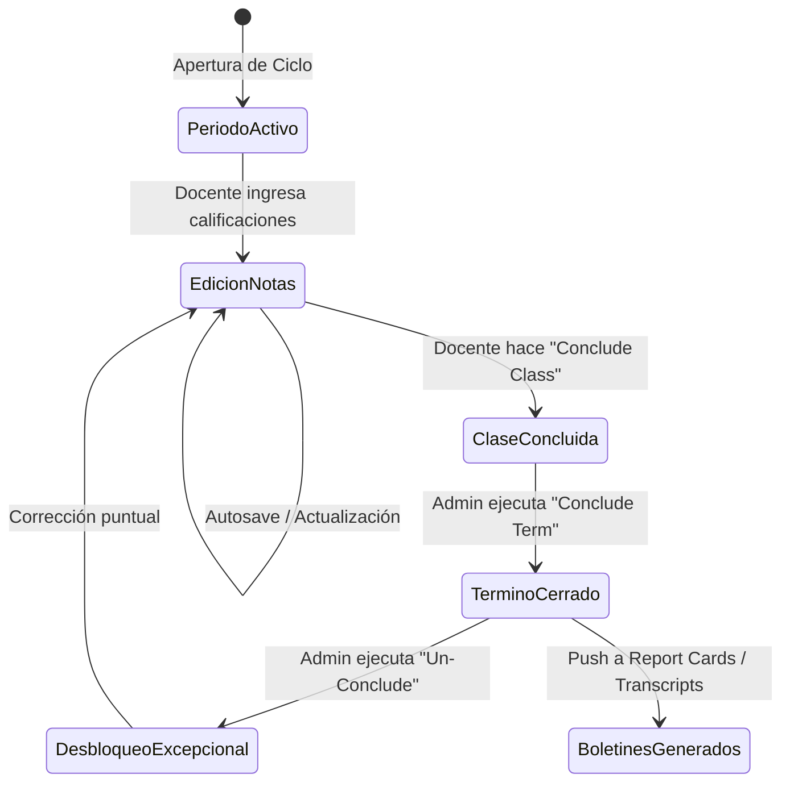

# Análisis Funcional: Cuaderno de Notas (Gradebook) — Gradelink

> **Plataforma analizada:** Gradelink SIS ([https://www.gradelink.com](https://www.gradelink.com))  
> **Módulo:** 01. Cuaderno de notas / Gradebook (escalas, ponderaciones, cálculo de promedios, cierre de notas)  
> **Metodología:** Ingeniería inversa funcional de caja limpia (*Clean Room Reverse Engineering*) basada en documentación técnica pública, guías oficiales de usuario, base de conocimiento y canales de soporte.  
> **Fecha de análisis:** Octubre 2026  
> **Estado:** Fase 1 a 4 completa para Gradelink.

---

## FASE 1 — Recopilación de Información Pública

### 1.1 Fuentes Consultadas y URLs de Referencia
* **Portal de funcionalidades oficial:** [Gradelink Gradebook Features](https://www.gradelink.com/features/gradebook/)
* **Documentación del GradeSheet:** [Gradelink Help Center - GradeSheet Overview](https://gradelink.zendesk.com/hc/en-us/articles/360028710291) / [Gradelink Support Community](https://support.gradelink.com)
* **Gestión de Escalas y Códigos de Calificación:** [Assignment Grade Codes](https://support.gradelink.com/hc/en-us/articles/360028456192-Assignment-Grade-Codes) y [Alternative Grades](https://support.gradelink.com/hc/en-us/articles/360028712391-Alternative-Grades)
* **Ponderaciones y Métodos de Cálculo:** [Assignment Types & Weights](https://support.gradelink.com/hc/en-us/articles/360028710311-Assignment-Types) y [Class Grade Calculations](https://support.gradelink.com/hc/en-us/articles/360028710331-How-Class-Grades-are-Calculated)
* **Cierre y Bloqueo de Períodos:** [Concluding Classes and Terms](https://support.gradelink.com/hc/en-us/articles/360028710351-Concluding-Classes)
* **Sincronización con Terceros:** [Google Classroom Sync with Gradebook](https://support.gradelink.com/hc/en-us/articles/360046555232-Google-Classroom-Integration) y [Gradelink Partner Ecosystem](https://www.gradelink.com/integrations/)
* **Demostraciones y Tutoriales en Video:** [Gradelink Official YouTube Channel](https://www.youtube.com/@gradelink)

---

### 1.2 Estructura de Navegación y Funcionalidades Públicas del Módulo
En Gradelink, el flujo de trabajo del cuaderno de notas se articula en torno a tres vistas principales:
1. **GradeSheet (Cuaderno del Profesor):** Matriz bidimensional donde las filas representan a los estudiantes y las columnas representan las tareas/actividades organizadas cronológicamente o por tipo. Muestra en el extremo derecho el promedio dinámico actual, la letra equivalente y el total de puntos.
2. **Assignment Types (Configuración de Categorías de la Clase):** Panel donde el docente define los grupos de evaluación (ej. Tareas, Quizzes, Exámenes, Proyectos), sus ponderaciones relativas (%) y reglas automáticas (ej. *Drop Lowest Score* o *Extra Credit*).
3. **Conclude Tab (Cierre del Término):** Panel de validación final donde el docente o administrador revisa los promedios acumulados, bloquea las calificaciones para edición y las envía a los boletines de calificaciones (*Report Cards*).

---

### 1.3 Roles Identificados en el Módulo y Matriz de Acceso
| Rol | Permisos y Capacidades en Gradebook |
| :--- | :--- |
| **Administrador Escolar** | Define las escalas maestras de calificación de la escuela (Standard A-F, Numérica 0-100, Cualitativa O/S/U, Escala AP/Honors con bonus GPA). Configura los *Assignment Grade Codes* globales (`EX`, `INC`, `AB`). Concluye términos completos o desbloquea (*Un-Conclude*) clases para rectificación de notas. |
| **Docente (Teacher)** | Configura los *Assignment Types* de sus clases asignadas. Crea, edita y elimina tareas. Ingresa notas numéricas, letras o códigos especiales con guardado en lote o individual. Asigna comentarios por estudiante. Ejecuta el cierre (*Conclude*) de su clase al finalizar el trimestre. |
| **Estudiante** | Visualización en modo solo-lectura de sus notas desglosadas por materia, categoría y tarea. Puede ver comentarios de retroalimentación, estado de entrega y porcentaje acumulado ponderado. [SUPUESTO: La institución puede ocultar notas hasta una fecha límite de publicación]. |
| **Padre / Tutor** | Vista idéntica a la del estudiante pero multi-alumno (selector de hijos). Configuración de alertas automáticas (recibe correos cuando la nota baja de un umbral específico, ej. < 70%, o cuando hay una tarea en estado Incompleto/Faltante). |

---

### 1.4 Integraciones y APIs Públicas
* **Google Classroom API:** Sincronización bidireccional selectiva. Permite importar tareas creadas en Google Classroom hacia categorías del GradeSheet de Gradelink y mapear automáticamente las notas ingresadas por el docente en Classroom.
* **Schoology / Canvas:** Exportación e importación nocturna de listas de estudiantes y calificaciones consolidadas.
* **Microsoft Office 365 (School Data Sync):** Sincronización de nóminas y membresía de clases.
* **Clever / ClassLink (OneRoster):** Protocolos estándar de intercambio de datos de alumnos y clases.

---

### 1.5 Cómo Solicitar Manualmente Demo / Sandbox en Gradelink
> [!IMPORTANT]
> **Pasos para solicitar una demo manual (Clean Room Compliance):**
> 1. Ingresar a la URL oficial: [https://www.gradelink.com/free-trial/](https://www.gradelink.com/free-trial/) o [https://www.gradelink.com/request-a-demo/](https://www.gradelink.com/request-a-demo/).
> 2. Completar el formulario con datos escolares reales o de prueba: Nombre, Apellido, Email corporativo/institucional, Nombre del colegio, Matrícula estimada de estudiantes (ej. 100-300), Teléfono institucional.
> 3. En la opción de tipo de prueba, seleccionar *"Pre-loaded demo account"* (cuenta de prueba con datos ficticios) o agendar sesión de presentación de 20 minutos con un asesor.
> 4. Gradelink enviará las credenciales a la casilla indicada con una URL de acceso a un entorno de pruebas aislado (*sandbox*).

---

## FASE 2 — Análisis Funcional del Cuaderno de Notas

### 2.1 Propósito del Módulo
Permitir a los docentes registrar, ponderar y consolidar las evaluaciones continuas de los estudiantes en un período académico, transformando actividades individuales en promedios formales respetando políticas institucionales de escalas, excepciones y auditoría, con publicación controlada hacia estudiantes, padres y el expediente oficial (SIS).

---

### 2.2 Modelos de Cálculo y Reglas Matemáticas en Gradelink

Gradelink implementa tres modos matemáticos de cálculo en el GradeSheet:

#### Modo A: Ponderación por Categorías con Peso Equitativo (Default Weighted Percentage)
* Cada categoría o *Assignment Type* $j$ tiene un porcentaje de peso $W_j$, donde $\sum W_j = 100\%$ (excluyendo créditos extra).
* Dentro de la categoría $j$, cada una de las $N_j$ tareas evaluadas tiene exactamente el mismo impacto porcentual ($w_i = W_j / N_j$).
* Para cada tarea $i$ de la categoría $j$, el porcentaje obtenido es $P_{ij} = \frac{\text{Score}_{ij}}{\text{MaxScore}_{ij}} \times 100$.
* El promedio de la categoría es:
  $$\text{Promedio}_j = \frac{1}{N_j} \sum_{i=1}^{N_j} P_{ij}$$
* La nota global de la clase es:
  $$\text{Nota Final} = \sum_{j=1}^{M} \left( \text{Promedio}_j \times \frac{W_j}{100} \right)$$
* *Caso borde (Categoría vacía):* Si una categoría aún no tiene tareas evaluadas en el período, su peso $W_j$ es redistribuido proporcionalmente entre las categorías que sí tienen tareas calificadas, para que el promedio acumulado del estudiante refleje su rendimiento actual sobre base 100%.

#### Modo B: Ponderación por Categorías Basada en Puntos (Weight Each Assignment by Points)
* La categoría $j$ mantiene su peso global $W_j$ (ej. Tareas = 30%, Exámenes = 70%).
* Sin embargo, las tareas dentro de la categoría no valen lo mismo: se ponderan por sus puntos brutos.
* Fórmula del promedio de categoría:
  $$\text{Promedio}_j = \frac{\sum_{i=1}^{N_j} \text{Score}_{ij}}{\sum_{i=1}^{N_j} \text{MaxScore}_{ij}} \times 100$$
* La nota final combina los promedios ponderados por el peso de cada categoría $W_j$.
* *Regla de Gradelink:* Esta modalidad **deshabilita** la función de "Descartar la nota más baja" (*Drop lowest*).

#### Modo C: Sistema de Puntos Totales Puro (Auto-Weight by Points)
* Las categorías funcionan como simples etiquetas de agrupación informativa (sin porcentaje).
* La nota del curso es la suma simple de todos los puntos obtenidos dividida por el total de puntos posibles:
  $$\text{Nota Final} = \frac{\sum \text{Score}_i}{\sum \text{MaxScore}_i} \times 100$$

---

### 2.3 Tratamiento de Casos Especiales y Borde

#### 1. Descarte de la Nota Más Baja (*Drop Lowest Score*)
* Se activa por categoría (*Assignment Type*).
* Gradelink busca la tarea de esa categoría con el menor porcentaje relativo $P_{ij}$ para ese estudiante específico.
* Esa tarea se marca visualmente (en verde) y se excluye de la suma del numerador y de la división ($N_j \leftarrow N_j - 1$).
* *Caso borde:* Si hay empate entre dos notas mínimas iguales, el sistema descarta solo una de ellas. Si solo hay 1 tarea en la categoría, no se descarta ninguna hasta que haya al menos 2.

#### 2. Crédito Adicional (*Extra Credit*)
* **Tipo Extra Credit:** Categoría que se suma por encima del 100% (marcada en azul). Aporta puntos al numerador sin aumentar el denominador global. Si un alumno obtiene 0 en una actividad extra, su nota no baja.
* **Tarea Extra Credit:** Tarea donde $\text{MaxScore} = 0$, pero el docente puede asignar puntos obtenidos. Esos puntos se suman directamente a la bonificación de la categoría.

#### 3. Códigos Especiales de Tarea (*Assignment Grade Codes*)
* `EX` (Excused / Exonerado): La tarea no se califica para ese estudiante. Se retira del cálculo tanto del numerador como del denominador de la categoría; el estudiante no es penalizado por no haber participado justificadamente.
* `INC` (Incomplete / Incompleto): Se almacena con un flag de pendiente. Puede computar temporalmente como 0% en el promedio hasta que se entregue o resolverse según política escolar.
* `AB` (Absent / Ausente): Marca administrativa para seguimiento de inasistencia a la evaluación.

#### 4. Redondeo y Precisión
* Las notas por tarea se calculan internamente con precisión de punto flotante y se muestran con 2 decimales (centésimas, ej. `92.48%`).
* El promedio acumulado y la nota de fin de ciclo en el GradeSheet se redondean a 1 decimal (décimas, ej. `92.5%`).

#### 5. Cierre y Congelamiento (*Concluding Terms / Lock Grades*)
* Una vez que el docente concluye su clase o el administrador concluye el término lectivo:
  * El estado de la clase pasa a `CONCLUDED`.
  * Toda la matriz del GradeSheet queda en **solo-lectura**.
  * Se genera una instantánea (*snapshot*) de la nota final, letra equivalente, créditos ganados y GPA en la tabla de registro histórico.
  * Para cualquier corrección posterior se requiere una acción explícita de `Un-Conclude` por parte de un usuario con rol de Administrador.

---

### 2.4 Matriz de Estados y Transiciones



---

### 2.5 Eventos y Notificaciones
1. **Calificación Publicada / Actualizada:**
   * Disparador: Docente guarda nota de una tarea o publica la evaluación.
   * Destinatario: Estudiante y Padres.
   * Canal: Notificación push en portal / correo si el usuario tiene activadas notificaciones inmediatas.
2. **Alerta de Rendimiento Crítico (Baja Calificación):**
   * Disparador: El promedio acumulado de la materia o una tarea cae por debajo del umbral institucional configurado (ej. < 70%).
   * Destinatario: Padres y Tutor Académico.
   * Contenido: "El estudiante [Nombre] ha obtenido [Nota] en la materia [Materia]. Su promedio actual es [Promedio]."
3. **Alerta de Tarea Faltante (Missing / Incomplete):**
   * Disparador: Pasa la fecha límite (`due_date`) y no existe registro de entrega ni calificación registrada.
   * Destinatario: Estudiante y Padre.

---

### 2.6 Preguntas Abiertas para Validación con Trial Real
* `[VERIFICAR]` ¿Gradelink recalcula en tiempo real en la base de datos o almacena los promedios calculados en una columna cacheada por estudiante/clase/período?
* `[VERIFICAR]` ¿Cómo gestiona Gradelink los cambios retrospectivos de escalas de calificación a mitad de período en clases ya evaluadas?
* `[SUPUESTO]` Los docentes no pueden ver las notas de otras asignaturas a menos que tengan el permiso de "Co-Teacher" o "Department Head".
* `[VERIFICAR]` ¿Existe auditoría granular (historial de quién modificó cada nota y cuándo) visible para el docente o únicamente en el panel de administrador?

---

## FASE 3 — Traducción Arquitectónica a Nuestro Stack

Nuestro stack de desarrollo:
* **Backend:** NestJS + PostgreSQL (TypeORM activo en base de datos; compatible con modelo relacional formal y esquemas Prisma).
* **Frontend:** React 19 + Next.js 16 (App Router) + TypeScript + Tailwind CSS v4.
* **Arquitectura:** Backend-First (toda fórmula matemática, validación de permisos, cálculo de promedios y redondeo se ejecuta exclusivamente en el servidor; el cliente jamás calcula el promedio final).

---

### 3.1 Estructura Propuesta de Carpetas en NestJS (`school_management_api`)

```text
src/modules/gradebook/
├── gradebook.module.ts
├── gradebook.controller.ts
├── gradebook.service.ts
├── services/
│   ├── gradebook-calculation.service.ts   # Motor matemático puro (promedios, drop lowest, extra credit)
│   └── gradebook-conclude.service.ts      # Auditoría, bloqueo y snapshots de cierre de término
├── dto/
│   ├── create-assignment-type.dto.ts
│   ├── update-assignment-type.dto.ts
│   ├── bulk-grade-entry.dto.ts
│   ├── grade-code-entry.dto.ts
│   ├── conclude-class.dto.ts
│   └── query-gradebook.dto.ts
├── entities/
│   ├── assignment-type.entity.ts
│   ├── grading-scale.entity.ts
│   ├── assignment-grade-code.entity.ts
│   ├── term-grade-snapshot.entity.ts
│   └── grade-audit-log.entity.ts
└── guards/
    ├── class-teacher.guard.ts             # Valida que el docente esté asignado a la clase y no esté concluida
    └── term-active.guard.ts               # Valida que el período académico esté abierto para modificaciones
```

---

### 3.2 Modelado de Datos: Esquema Prisma / DDL Relacional

A continuación se presenta el esquema de entidades con sus relaciones, índices y restricciones de integridad:

```prisma
// Esquema Prisma para Gradebook Profesional

enum CalculationMode {
  WEIGHTED_EQUAL_ASSIGNMENTS    // Modo A: Categorías con % fijo, tareas divididas equitativamente
  WEIGHTED_POINTS_ASSIGNMENTS   // Modo B: Categorías con % fijo, tareas ponderadas por sus puntos
  TOTAL_POINTS_PURE             // Modo C: Suma directa de puntos (sin porcentaje por tipo)
}

enum ClassTermStatus {
  OPEN                          // En curso, docentes pueden editar calificaciones
  CONCLUDED_TEACHER             // Docente cerró su clase, pendiente de cierre general
  CONCLUDED_ADMIN               // Período cerrado oficialmente, modo solo-lectura absoluto
}

model AcademicPeriod {
  id              Int               @id @default(autoincrement())
  academicYearId  Int               @map("academic_year_id")
  schoolCode      String            @map("school_code") @db.VarChar(50)
  name            String            @db.VarChar(100)
  code            String            @db.VarChar(50)
  startDate       DateTime          @map("start_date") @db.Date
  endDate         DateTime          @map("end_date") @db.Date
  weight          Decimal           @default(1.00) @db.Decimal(5, 2)
  status          String            @default("ACTIVE") @db.VarChar(20) // ACTIVE, CLOSED
  
  classes         ClassTermState[]
  termSnapshots   TermGradeSnapshot[]

  @@map("academic_periods")
}

model GradingScale {
  id            Int       @id @default(autoincrement())
  schoolCode    String    @map("school_code") @db.VarChar(50)
  name          String    @db.VarChar(100)
  scaleType     String    @map("scale_type") @db.VarChar(50) // LETTER_AF, NUMERIC_100, QUALITATIVE_OSNU, AP_HONORS
  scaleMapping  Json      @map("scale_mapping") // Array de { symbol: "A", minPercent: 93, maxPercent: 100, gpaValue: 4.0, isPassing: true }
  createdAt     DateTime  @default(now()) @map("created_at") @db.Timestamptz

  classes       Class[]

  @@map("grading_scales")
}

model AssignmentGradeCode {
  id                  Int       @id @default(autoincrement())
  schoolCode          String    @map("school_code") @db.VarChar(50)
  code                String    @db.VarChar(10) // EX, INC, AB
  label               String    @db.VarChar(50) // Excused, Incomplete, Absent
  description         String?   @db.Text
  isExempt            Boolean   @default(false) @map("is_exempt") // Excluye de cálculos (no penaliza)
  defaultPercentage   Decimal?  @map("default_percentage") @db.Decimal(5, 2) // Si se computa (ej. INC = 0.00%)
  createdAt           DateTime  @default(now()) @map("created_at") @db.Timestamptz

  @@unique([schoolCode, code])
  @@map("assignment_grade_codes")
}

model AssignmentType {
  id              Int       @id @default(autoincrement())
  classCode       String    @map("class_code") @db.VarChar(50)
  schoolCode      String    @map("school_code") @db.VarChar(50)
  name            String    @db.VarChar(100)
  weight          Decimal   @db.Decimal(5, 2) // Porcentaje del tipo (ej. 30.00)
  dropLowest      Boolean   @default(false) @map("drop_lowest") // Gradelink feature: descartar nota más baja
  isExtraCredit   Boolean   @default(false) @map("is_extra_credit") // Tipo extra credit
  description     String?   @db.Text
  createdAt       DateTime  @default(now()) @map("created_at") @db.Timestamptz
  createdBy       String?   @map("created_by") @db.Uuid

  assignments     Assignment[]

  @@map("assignment_types")
}

model ClassTermState {
  id                Int             @id @default(autoincrement())
  classCode         String          @map("class_code") @db.VarChar(50)
  academicPeriodId  Int             @map("academic_period_id")
  calculationMode   CalculationMode @default(WEIGHTED_EQUAL_ASSIGNMENTS) @map("calculation_mode")
  status            ClassTermStatus @default(OPEN)
  concludedAt       DateTime?       @map("concluded_at") @db.Timestamptz
  concludedBy       String?         @map("concluded_by") @db.Uuid
  unconcludedAt     DateTime?       @map("unconcluded_at") @db.Timestamptz
  unconcludedBy     String?         @map("unconcluded_by") @db.Uuid

  period            AcademicPeriod  @relation(fields: [academicPeriodId], references: [id])

  @@unique([classCode, academicPeriodId])
  @@map("class_term_states")
}

model TermGradeSnapshot {
  id                Int             @id @default(autoincrement())
  academicPeriodId  Int             @map("academic_period_id")
  classCode         String          @map("class_code") @db.VarChar(50)
  studentId         String          @map("student_id") @db.Uuid
  finalScore        Decimal         @map("final_score") @db.Decimal(5, 2) // Promedio final (ej. 92.5)
  letterEquivalent  String?         @map("letter_equivalent") @db.VarChar(10) // ej. "A"
  gpaPoint          Decimal?        @map("gpa_point") @db.Decimal(4, 2) // ej. 3.70
  isPassing         Boolean         @default(true) @map("is_passing")
  alternativeGrade  String?         @map("alternative_grade") @db.VarChar(10) // W, INC, AUD
  generatedAt       DateTime        @default(now()) @map("generated_at") @db.Timestamptz
  approvedBy        String?         @map("approved_by") @db.Uuid

  period            AcademicPeriod  @relation(fields: [academicPeriodId], references: [id])

  @@unique([academicPeriodId, classCode, studentId])
  @@map("term_grade_snapshots")
}

model GradeAuditLog {
  id              Int       @id @default(autoincrement())
  assignmentId    Int       @map("assignment_id")
  studentId       String    @map("student_id") @db.Uuid
  previousScore   Decimal?  @map("previous_score") @db.Decimal(6, 2)
  newScore        Decimal?  @map("new_score") @db.Decimal(6, 2)
  previousCode    String?   @map("previous_code") @db.VarChar(10)
  newCode         String?   @map("new_code") @db.VarChar(10)
  reason          String?   @db.Text
  changedBy       String    @map("changed_by") @db.Uuid
  changedAt       DateTime  @default(now()) @map("changed_at") @db.Timestamptz

  @@map("grade_audit_logs")
}
```

---

### 3.3 Entidades TypeORM para Integración Inmediata con `school_management_api`

Dado que el backend del usuario está construido sobre **TypeORM**, aquí está la definición exacta compatible con su ORM actual:

```typescript
// src/modules/gradebook/entities/assignment-type.entity.ts
import { Entity, PrimaryGeneratedColumn, Column, CreateDateColumn, OneToMany } from 'typeorm';
import { Assignment } from '../../assignments/entities/assignment.entity';

@Entity('assignment_types')
export class AssignmentType {
  @PrimaryGeneratedColumn()
  id: number;

  @Column({ name: 'class_code', length: 50, nullable: true })
  classCode: string;

  @Column({ name: 'school_code', length: 50 })
  schoolCode: string;

  @Column({ length: 100 })
  name: string;

  @Column('numeric', { precision: 5, scale: 2 })
  weight: number;

  @Column({ name: 'drop_lowest', default: false })
  dropLowest: boolean;

  @Column({ name: 'is_extra_credit', default: false })
  isExtraCredit: boolean;

  @Column('text', { nullable: true })
  description: string;

  @CreateDateColumn({ name: 'created_at', type: 'timestamp with time zone' })
  createdAt: Date;

  @Column('uuid', { name: 'created_by', nullable: true })
  createdBy: string;

  @OneToMany(() => Assignment, (assignment) => assignment.type)
  assignments: Assignment[];
}
```

---

### 3.4 Especificación de Endpoints REST (API Contract)

| Método | Endpoint | Roles | Descripción | Payload / Parámetros |
| :--- | :--- | :--- | :--- | :--- |
| `GET` | `/api/v1/gradebook/class/:classCode` | `ADMIN`, `TEACHER` | Obtiene la matriz completa del GradeSheet (alumnos, tareas agrupadas por tipo, ponderaciones y promedios computados en backend). | Params: `classCode`, Query: `periodId?` |
| `POST` | `/api/v1/gradebook/bulk-entry` | `TEACHER`, `ADMIN` | Registro o actualización masiva de calificaciones por columna o celda con autosave. | `{ assignmentId: number, grades: [{ studentId: string, score?: number, code?: string, comments?: string }] }` |
| `POST` | `/api/v1/gradebook/class/:classCode/types` | `TEACHER`, `ADMIN` | Crea o actualiza categorías (*Assignment Types*) con validación de suma de pesos = 100%. | `{ name: string, weight: number, dropLowest: boolean, isExtraCredit: boolean }` |
| `POST` | `/api/v1/gradebook/class/:classCode/conclude` | `TEACHER`, `ADMIN` | Concluye la clase para el período: congela notas y genera el snapshot oficial. | `{ periodId: number, notes?: string }` |
| `POST` | `/api/v1/gradebook/class/:classCode/un-conclude` | `ADMIN` | Desbloquea una clase concluida para rectificaciones con motivo obligatorio. | `{ periodId: number, reason: string }` |
| `GET` | `/api/v1/gradebook/student/:studentId/class/:classCode` | `STUDENT`, `PARENT`, `TEACHER`, `ADMIN` | Vista detallada del estudiante con desglose por categorías y promedios parciales. | Params: `studentId`, `classCode` |

---

### 3.5 Lógica de Negocio en NestJS: Motor de Cálculo Puro

```typescript
// src/modules/gradebook/services/gradebook-calculation.service.ts
import { Injectable } from '@nestjs/common';

export interface EvaluatedAssignment {
  id: number;
  typeId: number;
  maxScore: number;
  score: number | null;
  code?: string | null;      // 'EX', 'INC', etc.
  isExempt?: boolean;
}

export interface AssignmentTypeRule {
  id: number;
  name: string;
  weight: number;            // ej: 40.00
  dropLowest: boolean;
  isExtraCredit: boolean;
}

@Injectable()
export class GradebookCalculationService {
  /**
   * Calcula el promedio acumulado del estudiante aplicando las reglas de Gradelink
   */
  calculateStudentGrade(
    types: AssignmentTypeRule[],
    assignments: EvaluatedAssignment[],
  ): { finalPercentage: number; categoryBreakdown: any[] } {
    let totalWeightedScore = 0;
    let totalEffectiveWeight = 0;
    const categoryBreakdown: any[] = [];

    for (const type of types) {
      // Filtrar tareas que pertenecen a este tipo y que no estén exoneradas (EX)
      const typeAssignments = assignments.filter(
        (a) => a.typeId === type.id && !a.isExempt,
      );

      // Si no hay tareas calificables en esta categoría, se omite su peso del denominador
      if (typeAssignments.length === 0) {
        continue;
      }

      // Convertir cada tarea a porcentaje (0 - 100)
      let taskPercentages = typeAssignments
        .filter((a) => a.score !== null)
        .map((a) => ({
          assignmentId: a.id,
          percentage: (Number(a.score) / Number(a.maxScore)) * 100,
        }));

      if (taskPercentages.length === 0) {
        continue;
      }

      // Regla Gradelink: Drop Lowest Score
      if (type.dropLowest && taskPercentages.length > 1) {
        let lowestIdx = 0;
        let minScore = taskPercentages[0].percentage;
        for (let i = 1; i < taskPercentages.length; i++) {
          if (taskPercentages[i].percentage < minScore) {
            minScore = taskPercentages[i].percentage;
            lowestIdx = i;
          }
        }
        // Descartar la nota más baja
        taskPercentages.splice(lowestIdx, 1);
      }

      // Promedio aritmético de la categoría (Modo A: Equal Weights within Category)
      const categoryAverage =
        taskPercentages.reduce((sum, item) => sum + item.percentage, 0) /
        taskPercentages.length;

      const typeWeight = Number(type.weight);

      if (type.isExtraCredit) {
        // Extra credit suma puntos al numerador sin alterar el peso base
        totalWeightedScore += (categoryAverage * typeWeight) / 100;
      } else {
        totalWeightedScore += (categoryAverage * typeWeight) / 100;
        totalEffectiveWeight += typeWeight;
      }

      categoryBreakdown.push({
        typeId: type.id,
        typeName: type.name,
        average: Number(categoryAverage.toFixed(2)),
        weight: typeWeight,
        isExtraCredit: type.isExtraCredit,
        countedTasks: taskPercentages.length,
      });
    }

    // Normalizar si el peso efectivo no es exactamente 100 (ej. periodos con categorías aún sin tareas)
    const finalPercentage =
      totalEffectiveWeight > 0
        ? (totalWeightedScore / totalEffectiveWeight) * 100
        : 0;

    return {
      finalPercentage: Number(finalPercentage.toFixed(1)), // Redondeo a 1 decimal estilo Gradelink
      categoryBreakdown,
    };
  }
}
```

---

### 3.6 Guards y Decoradores de Permisos por Rol en NestJS

```typescript
// src/modules/gradebook/guards/can-edit-gradebook.guard.ts
import { Injectable, CanActivate, ExecutionContext, ForbiddenException } from '@nestjs/common';
import { Reflector } from '@nestjs/core';

@Injectable()
export class CanEditGradebookGuard implements CanActivate {
  constructor(private reflector: Reflector) {}

  async canActivate(context: ExecutionContext): Promise<boolean> {
    const request = context.switchToHttp().getRequest();
    const user = request.user;
    const classCode = request.params.classCode || request.body.classCode;

    // SuperAdmin y Admin siempre tienen acceso de supervisión
    if (user.roles.includes('SUPERADMIN') || user.roles.includes('ADMIN')) {
      return true;
    }

    // Si es docente: verificar que la clase le pertenezca
    if (user.roles.includes('TEACHER')) {
      const isAssigned = await this.verifyTeacherClassAssignment(user.id, classCode);
      if (!isAssigned) {
        throw new ForbiddenException('No tiene permisos para calificar esta clase asignada a otro docente.');
      }

      // Verificar que la clase no esté en estado CONCLUDED
      const isConcluded = await this.verifyClassConcludedStatus(classCode);
      if (isConcluded) {
        throw new ForbiddenException('El período lectivo para esta clase está concluido. Contacte al administrador para rectificaciones.');
      }

      return true;
    }

    throw new ForbiddenException('Rol no autorizado para modificar calificaciones.');
  }

  private async verifyTeacherClassAssignment(teacherId: string, classCode: string): Promise<boolean> {
    // Consulta a DB validando teacher_id en classes
    return true; 
  }

  private async verifyClassConcludedStatus(classCode: string): Promise<boolean> {
    // Consulta a DB en class_term_states
    return false;
  }
}
```

---

### 3.7 Componentes React Necesarios en el Frontend (`school_management_web`)

Para replicar y superar la experiencia de Gradelink con una interfaz moderna y fluida:

1. **`GradeSheetMatrix.tsx`:**
   * Tabla con encabezados de columna agrupados por categoría de tarea (*badge de color por categoría*).
   * Celdas editables estilo hoja de cálculo: navegación con flechas de teclado (`Up`, `Down`, `Enter`, `Tab`).
   * Soporte de atajos rápidos para códigos especiales: presionar `E` asigna `EX` (Excusado), `I` asigna `INC` (Incompleto).
   * Columna fija a la derecha (*sticky column*) que refleja en tiempo real el promedio ponderado, badge de letra (A, B, C...) y estado de aprobación.
2. **`AssignmentTypeConfigModal.tsx`:**
   * Diálogo donde el profesor gestiona categorías, ingresa pesos numéricos y activa checkboxes de *Drop Lowest* y *Extra Credit*.
   * Indicador interactivo de progreso de suma total: barra que marca en verde si suma `100%`, o en rojo con mensaje de error si suma más o menos de 100%.
3. **`ConcludeClassDialog.tsx`:**
   * Modal de confirmación para el cierre del período. Muestra resumen estadístico (promedio general del curso, alumnos aprobados/reprobados, tareas con calificaciones pendientes) antes de confirmar el bloqueo definitivo.
4. **`StudentGradeDetailDrawer.tsx`:**
   * Panel lateral deslizante que muestra al docente, alumno o padre el desglose detallado de cómo se calculó la nota del estudiante por cada categoría.

---

### 3.8 Diagnóstico y Plan de Reutilización del Código Actual

Al examinar la base de código actual:
1. **Frontend (`src/app/(dashboard)/teacher/grading/page.tsx`):**
   * Actualmente contiene **1,606 líneas** en un solo archivo monolítico, mezclando la vista de entregas de tareas (*submissions*), previsualizaciones de PDF y el cuaderno de notas.
   * **Reutilizable:** Los estados de filtrado, el consumo de `assignmentsService.getGradebook(classCode)`, los diálogos de retroalimentación y la previsualización de documentos adjuntos.
   * **A refactorizar:** Extraer la matriz de cálculo a un componente modular `GradeSheetTable` que soporte edición en celda en lote (actualmente solo edita modal por modal alumno por alumno), y delegar todo el cálculo de promedios al backend respetando la regla `arquitectura-backend-first`.
2. **Servicio (`src/lib/services/assignments.service.ts`):**
   * Ya contiene las interfaces base `ClassGradebook`, `StudentGradeSummary` y el método `gradeStudent`.
   * **Añadir:** Métodos `bulkGradeStudents`, `updateAssignmentTypes` y `concludeClassTerm`.
3. **Base de Datos (`PostgreSQL`):**
   * Las tablas `assignments`, `assignment_types`, `grades_records`, `grading_scales` y `academic_periods` ya existen en Postgres.
   * **Mejoras necesarias:**
     * Agregar las columnas `drop_lowest` (boolean) y `is_extra_credit` (boolean) a `assignment_types`.
     * Crear la tabla `class_term_states` para soportar el flujo de conclusión y bloqueo de notas.
     * Crear la tabla de auditoría `grade_audit_logs`.

---

## Conclusiones del Módulo 01 (Gradelink)
Gradelink demuestra que la solidez de un SIS radica en:
1. **Claridad en las reglas de cálculo** (ponderaciones rígidas al 100% que evitan ambigüedad legal en promedios escolares).
2. **Tratamiento explícito de excepciones** (`EX` para no penalizar, `INC` para seguimiento de moras académicas).
3. **Flujo de bloqueo formal (*Conclude*)** que separa la etapa de docencia activa de la etapa de secretaría académica y reporte oficial.
